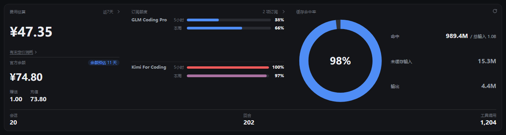
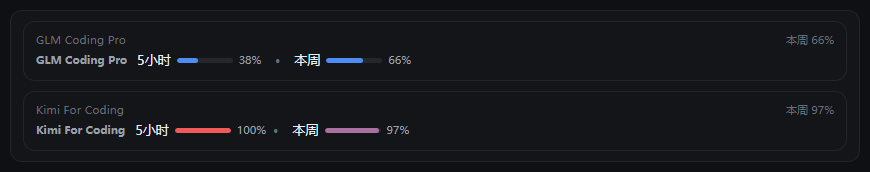
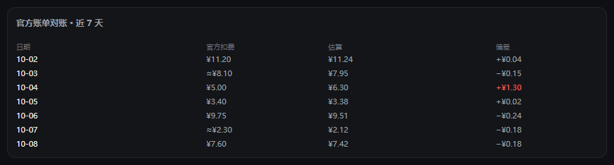

<p align="center">
  <picture>
    <source media="(prefers-color-scheme: dark)" srcset="assets/logo-dark.svg">
    
  </picture>
</p>

# dsh-pulse

A usage and cost observatory for [DeepSeek Harness](https://github.com/deepseek-ai/deepseek-harness) sessions. It folds every session (live or persisted, from any frontend) into token trends, prices them at the official DeepSeek rates, and puts the platform balance and subscription quotas next to the estimate. Pure UI: no model-visible tools, no tokens spent by the plugin, and usage data never leaves this machine.

[简体中文](./README.md) · **English** · [Documentation](./docs/en/) · [Changelog](./CHANGELOG.md)



## What you get

- **Usage trends**: hourly / daily / 90-day and 1-year heatmaps for any window up to 30 days; click through a day into per-model and input/cache/output splits, with model share and project ranking beside the trend.
- **Cost estimate with a reality check**: official peak/off-peak rates, per-model and per-provider pricing, unpriced usage called out instead of folded into the total; expand the card for the monthly budget and a daily reconciliation table between local estimate and official spend.
- **Balance and subscriptions**: the DeepSeek platform balance beside the estimate, plus monthly coding plans (GLM Coding Plan, Kimi For Coding, MiniMax Coding Plan, OpenCode Go) with 5-hour / weekly windows, reset times, burn-rate forecast and per-project burn.
- **Session detail**: sessions grouped by project with subagent subtotals; a subagent is named by its own task label and sits right after the parent that spawned it. Place up to three breaks on a session's cumulative-consumption curve to read each segment's tokens and cost.
- **Collaboration attribution**: subagent and team usage by family — each member's task label, model, tokens, off-peak share and share of the family — plus timeline report and failure counts. Tokens attribute down to the session, never to a task.
- **Anomaly watch**: days burning ≥3× the 7-day P95, and sessions repeating one tool call dozens of times in a day. Numbers and identifiers only; no advice.
- **Fits the workflow**: a compact overlay from the `/` menu scoped to the current session, shared project/model filters, four themes, CSV export, and a draggable panel width.

Subscription-quota and reconciliation expansions:





## Install

```bash
dsh plugin --profile web add -w dsh-pulse
```

Restart `dsh web` — the host side registers at plugin load — then open **Settings → Usage Pulse**. Three ways in: the button at the sidebar's foot, the settings page, and the **pulse** row in any conversation's `/` menu, which opens an overlay scoped to that session's workspace. All of them share one data source, `GET /pulse/stats`; the panel's left edge drags to resize.

```bash
# update / remove
dsh plugin --profile web add -w dsh-pulse@latest
dsh plugin --profile web remove -w dsh-pulse
```

Other sources install the same way — re-run `add` with the tarball, git URL or `link:` checkout you want:

```bash
dsh plugin --profile web add -w /abs/path/to/dsh-pulse-<version>.tgz
dsh plugin --profile web add -w link:/abs/path/to/dsh-pulse
```

If a `DEEPSEEK_API_KEY` is already configured, the balance and reconciliation lines appear automatically.

## Privacy and data

- **The source of truth is dsh's own session logs.** There is no plugin-private usage history: every number is folded at request time. Uninstall, reinstall, even delete the projection cache — the full history comes back.
- **Three plugin-owned snapshot files**, all optional and all deletable: balance snapshots (amounts only, rolling 30 days), quota snapshots (one percentage per window, rolling 30 days), and the data-card snapshot (the imported/pulled data card; deleting it falls back to the bundled card). The first two only feed the reconciliation line and the burn forecast.
- **Credentials never persist.** The API key stays in the host process and appears in exactly one outbound `Authorization` header per request.
- **Exactly four kinds of outbound requests**: official balance, subscription quota, the manual update check on the About panel (bottom of the plugin's Settings tab), and the manual **pull** on the data-card panel (the default source is the repo's data card over jsDelivr, configurable via `pricingCardSource`). Balance and quota poll every 60 seconds only while their surface is visible; the update check and the pull are button-triggered only. There is no telemetry.
- **Zero model-visible surface by default.** The main package registers no tools. The optional companion package `dsh-pulse-usage-query` adds one read-only tool and is [not mounted unless you mount it yourself](https://github.com/Enc-hanted/dsh-pulse/blob/main/packages/dsh-pulse-usage-query/README.md).

Full storage table: [Configuration → Data & storage](./docs/en/CONFIGURATION.md#data--storage).

## Configuration

Day-to-day settings live in **Settings → Usage Pulse**: pricing and cost, display and theme, plan comparison, and the manual update check. The monthly budget is a card on the dashboard itself. Per-profile overrides go in `cordis.patch.yml`:

```yaml
- insert:
    - id: pulse
      name: 'dsh-pulse'
      config:
        defaultDays: 30
        topProjects: 8
        costEnabled: true
        usdToCny: 6.8
        monthlyProviders: []
```

Rates are CNY per million tokens and default to the official price page; peak windows are Beijing-time weekdays 09:00–12:00 and 14:00–18:00, every other slot is half price. The [configuration reference](./docs/en/CONFIGURATION.md) covers the full option table, custom peak hours, per-provider pricing, monthly-paid providers and the aux-call estimate.

## Compatibility

- **dsh ≥ 0.2.0-rc.2 (the 0.2.x family)**, Node ≥ 22.19. Seam packages are peers, so the plugin always runs against the host's own copies.
- **Web frontend**: the full observatory and the session overlay.
- **Terminal face (optional)**: mounts inside [dsh-tui](https://github.com/ccch1mneyyy/dsh-TUI) ≥ 0.13.0 (verified on 0.16.1) and serves `/pulse`, `/pulse-day`, `/pulse-month`, `/pulse-year`, `/pulse-cost`, `/pulse-sessions`. The mini card sits above the input box; `Esc` unwinds the scene level by level.
- **Usage is frontend-agnostic**: sessions run from Web, dsh-tui, headless or ACP are all counted.

Degradations, diagnostics and the 0.1.x generation history: [Compatibility notes](./docs/en/COMPATIBILITY.md).

## FAQ

- **No data in the panel?** A fresh install has no history to fold yet — run a session; also make sure the plugin is installed in the active profile and `dsh web` was restarted.
- **No balance block?** The host needs a DeepSeek API key (`DEEPSEEK_API_KEY` or a client sign-in); without one the block hides itself.
- **Estimate and official spend differ?** The official number is that key's total spend — other tools sharing the key count too; helper calls are estimates that self-calibrate, and a persistent drift raises an alert.
- **Subscription percentages look low?** Plans report percentages only; the total is back-solved from this machine's traffic, so a shared key reads low. Read it as a trend.
- **A save returned 409?** It raced another window's save; the editor has already refreshed — just retry.
- **`/pulse` missing in dsh-tui?** Check the plugin is installed in the `dsh-tui` profile too and restart it; one `C-070 … unattributed` line in the boot log is expected.

## Development

```bash
npm ci
npm test          # 12 suites: host, aggregate, reconcile, view, card, quota adapters, package shape, client smoke, TUI, golden, style, manifest
npm run typecheck
npm run build     # rebuild lib/client.js from src/
```

Build setup, test map, extension slots for plugin authors and the release checklist: [Development](./docs/en/DEVELOPMENT.md).

Special thanks to the [Linux Do](https://linux.do/) community.

MIT — see [LICENSE](./LICENSE).

[](https://github.com/deepseek-ai/deepseek-harness)
