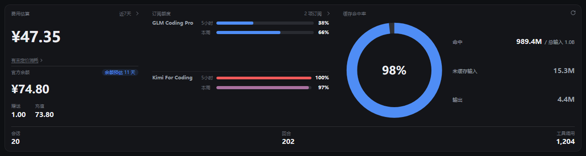
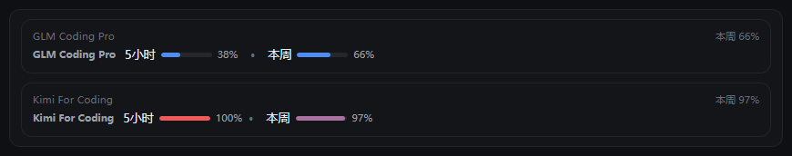
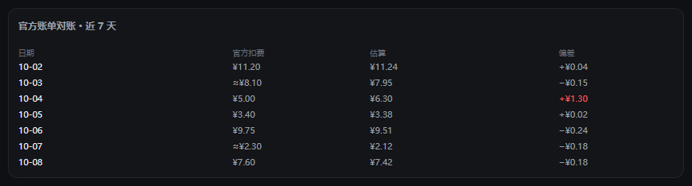

<p align="center">
  <picture>
    <source media="(prefers-color-scheme: dark)" srcset="assets/logo-dark.svg">
    
  </picture>
</p>

# dsh-pulse

[DeepSeek Harness](https://github.com/deepseek-ai/deepseek-harness) 的会话用量与费用观测台。它把每个会话——无论活跃还是已持久化、来自哪种前端——折算成 token 走势，按 DeepSeek 官方费率计价，并把平台余额与订阅额度放在估算旁边。纯界面：没有模型可见的工具，插件不消耗 token，数据不离开本机。

**简体中文** · [English](./README.en.md) · [文档](./docs/) · [更新日志](./CHANGELOG.md)



## 功能

- **用量走势**：不超过 30 天的任意窗口，提供小时 / 每日 / 90 天与 1 年热力图；点进某一天可下钻到逐模型以及输入 / 缓存 / 输出的拆分，模型占比与项目排行就在走势旁边。
- **费用估算与对账**：按官方峰谷费率计价，逐模型、逐供应商定价，未定价用量单独列出而不并入总额；展开卡片可看月度预算与本地估算、官方扣费的逐日对账表。
- **余额与订阅**：估算旁边就是 DeepSeek 平台余额，另有月付 Coding 套餐（GLM Coding Plan、Kimi For Coding、MiniMax Coding Plan），带 5 小时 / 每周窗口、重置时刻、燃速预估与分项目消耗。
- **会话明细**：会话按项目分组并带子代理小计；在会话的累计消耗曲线上放最多三个断点，即可读出每一段的 token 与费用。
- **异常观察**：单日消耗达到前 7 日 P95 的 3 倍以上，以及一天内把同一工具调用重复几十次的会话。只给数字与标识，不告诉你该怎么做。
- **贴合工作流**：从 `/` 菜单打开、限定于当前会话的精简浮层，共享的项目 / 模型过滤器，四套主题，CSV 导出，面板宽度可拖拽。

订阅额度与对账的展开图：





## 安装

```bash
dsh plugin --profile web add -w dsh-pulse
```

重启 `dsh web`——宿主侧在插件加载时完成注册——然后打开 **设置 → 用量观测台**。入口有三处：侧栏底部按钮、设置页，以及任意对话 `/` 菜单中的 **pulse** 一行（打开限定于该会话工作区的浮层）。三者共用同一个数据源 `GET /pulse/stats`；面板左缘可拖拽调宽。

```bash
# update / remove
dsh plugin --profile web add -w dsh-pulse@latest
dsh plugin --profile web remove -w dsh-pulse
```

其他来源用同样的命令安装——用你需要的 tarball、git URL 或 `link:` 检出重新 `add` 一次：

```bash
dsh plugin --profile web add -w /abs/path/to/dsh-pulse-<version>.tgz
dsh plugin --profile web add -w link:/abs/path/to/dsh-pulse
```

若已配置 `DEEPSEEK_API_KEY`，余额与对账线会自动出现。

## 隐私与数据

- **事实来源是 dsh 自己的会话日志。** 插件没有私有的用量历史：每个数字都在请求时折出。卸载、重装，甚至删掉投影缓存，完整历史都会重新折出。
- **两个插件自有的快照文件**，都是可选的，也都可以删：余额快照（只存金额，滚动 30 天）与额度快照（每个窗口一个百分比，滚动 30 天）。它们只用于对账线和燃速预估。
- **凭据从不落盘。** API key 只留在宿主进程内，每次请求只出现在一个出站 `Authorization` 头里。
- **出站请求只有三类**：官方余额、订阅额度，以及「关于」面板（插件「设置」标签页底部）上的手动检查更新——绝不自动发起，没有遥测。
- **默认没有任何模型可见的接口。** 主包不注册任何工具。可选的配套包 `dsh-pulse-usage-query` 增加一个只读工具，[只有你自己挂载才会生效](https://github.com/Enc-hanted/dsh-pulse/blob/main/packages/dsh-pulse-usage-query/README.md)。

完整存储表：[配置 → 数据与存储](./docs/CONFIGURATION.md#data--storage)。

## 配置

日常设置都在 **设置 → 用量观测台**：定价与费用、显示与主题、方案对比，以及手动检查更新；月度预算则是仪表盘上的一张卡片。按 profile 的覆盖写在 `cordis.patch.yml`：

```yaml
- insert:
    - id: pulse
      name: 'dsh-pulse'
      config:
        defaultDays: 30
        topProjects: 8
        costEnabled: true
        usdToCny: 6.8
        monthlyProviders: []
```

单价以每百万 token 的 CNY 金额计，默认取自官方价格页；高峰时段为北京时间工作日的 09:00–12:00 与 14:00–18:00，其余时段一律半价。[配置参考](./docs/CONFIGURATION.md)覆盖完整选项表、自定义高峰时段、逐供应商定价、月付供应商与辅助调用（估算）。

## 兼容性

- **dsh ≥ 0.2.0-rc.2（0.2.x 系列）**，Node ≥ 22.19。接缝包是 peer 依赖，插件始终运行在宿主自己的副本上。
- **Web 前端**：完整观测台与会话浮层。
- **终端面（可选）**：挂载于 [dsh-tui](https://github.com/ccch1mneyyy/dsh-TUI) ≥ 0.13.0（已在 0.16.1 上验证），提供 `/pulse`、`/pulse-day`、`/pulse-month`、`/pulse-year`、`/pulse-cost`、`/pulse-sessions`。迷你卡位于输入框上方；`Esc` 逐级返回上一场景。
- **用量与前端无关**：Web、dsh-tui、headless 或 ACP 跑出的会话都会被统计。

降级行为、诊断与 0.1.x 代际的历史见[兼容性说明](./docs/COMPATIBILITY.md)。

## FAQ

- **面板没有数据？** 刚装完没有可折的历史——先跑一个会话；同时确认插件装在活跃 profile 中，且 `dsh web` 已重启。
- **没有余额块？** 宿主需要配置 DeepSeek API key（`DEEPSEEK_API_KEY` 或客户端登录）；没有时该块自动隐藏。
- **估算与官方扣费不一致？** 官方数字是那把 key 的总扣费——共用同一把 key 的其他工具也会算进来；辅助调用是估算，会自我校准，偏差持续时会触发告警。
- **订阅百分比看起来偏低？** 套餐只上报百分比；总额由本机流量反推，共用 key 时读数会偏低。按趋势看即可。
- **保存返回 409？** 与其他窗口的保存撞车了；编辑器已自动刷新，重试即可。
- **dsh-tui 里没有 `/pulse`？** 确认插件也装在 `dsh-tui` profile 中并重启；启动日志里出现一行 `C-070 … unattributed` 属预期。

## 开发

```bash
npm ci
npm test          # 10 suites: host, aggregate, view, quota adapters, package shape, client smoke, TUI, golden, style, manifest
npm run typecheck
npm run build     # rebuild lib/client.js from src/
```

构建配置、测试地图、面向插件作者的扩展槽位与发版清单见[开发](./docs/DEVELOPMENT.md)。

特别致谢 [Linux Do](https://linux.do/) 社区。

MIT — 见 [LICENSE](./LICENSE)。
